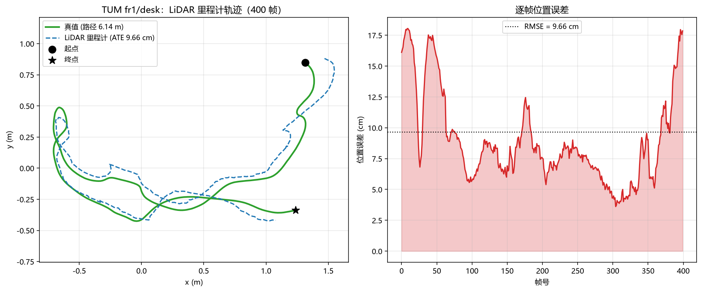
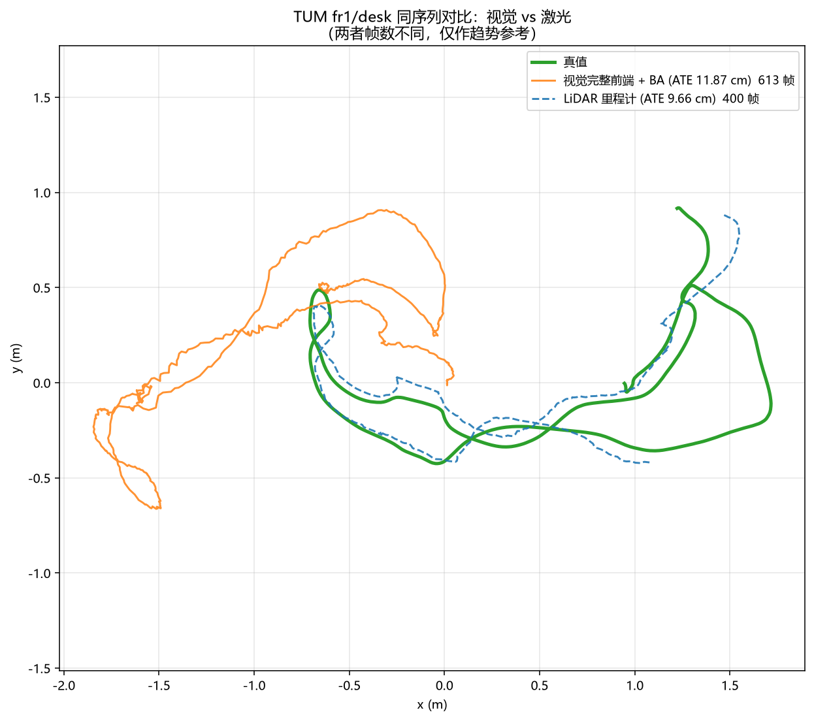
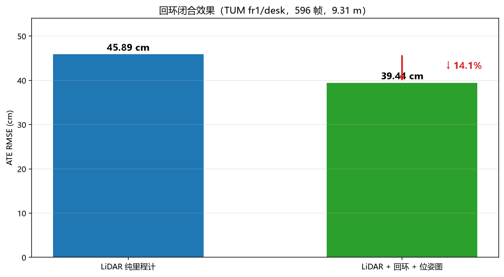
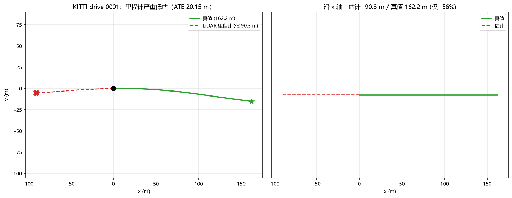
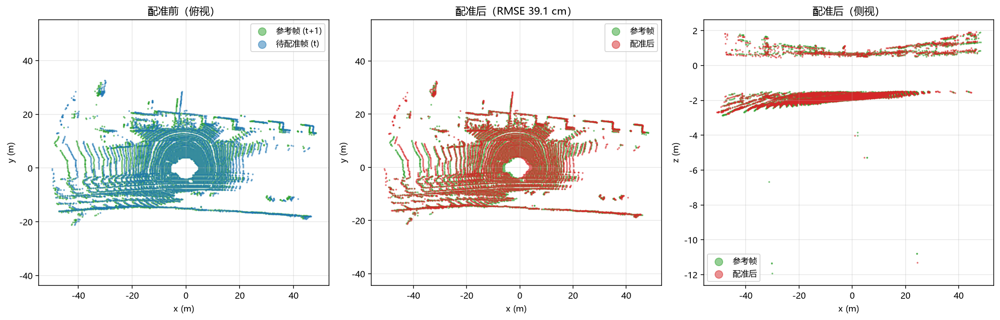
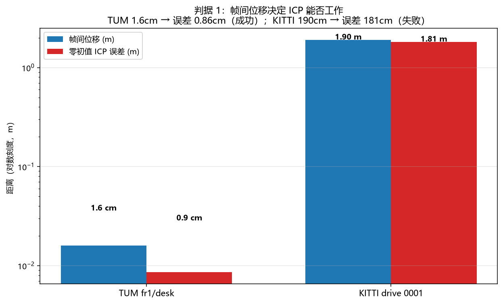

# 激光雷达前端扩展 / 点云配准 / 激光里程计

在 RGB-D SLAM 项目（`../`）基础上，把视觉前端换成激光（点云）前端，
验证「传感器前端可替换」的设计，并确定点到点/点到面 ICP 类方法的能力边界。

不依赖 open3d / PCL / g2o / Ceres：点云 IO、体素下采样、KD-Tree 近邻、PCA 法向量、
ICP、NDT、点面几何 BA、位姿图接入均在本目录内自行实现（numpy / scipy）。

数据集：
- TUM RGB-D `fr1/desk`（613 帧 RGB，595 帧深度，深度图转点云作为「激光」输入）
- KITTI raw `2011_09_26_drive_0001`（108 帧 Velodyne 点云，作为高速场景对照）

数据不随仓库提供，见文末「数据准备」。

---

## 一、系统链路

```
深度图 / 点云 (.bin)
   ↓   限距、去地面、体素下采样、法向量估计        pointcloud.py
激光里程计          帧间 ICP (p2p / p2pl) → 位姿累乘   lidar_odometry.py
   ↓                                              tum_lidar_odometry.py
局部地图里程计      帧 → 最近 N 帧融合地图            local_map_odometry.py
   ↓
几何 BA             点面残差联合优化位姿与地图点      lba.py / lba2.py
   ↓
回环检测            位姿距离候选 + ICP 验证 + 路程间隔过滤   lidar_loop_closure.py
   ↓
SE(3) 位姿图优化    复用 ../pose_graph.py            lidar_pose_graph.py
   ↓
轨迹 → ATE（去重心 + 只做刚体旋转对齐，与视觉方案同口径）
```

---

## 二、实测结果

| 方案 | 序列 | 帧数 | ATE RMSE | 状态 |
|---|---|---|---|---|
| 激光里程计 + 位姿图 | TUM fr1/desk | 400 | **9.66 cm** | ✅ |
| 激光里程计 | TUM fr1/desk | 400 | 9.74 cm | ✅ |
| 激光里程计 + **回环** + 位姿图 | TUM fr1/desk | 596 | **39.44 cm** | ✅ 较纯里程计 ↓14% |
| 激光里程计 | TUM fr1/desk | 596 | 45.89 cm | ✅ |
| 激光里程计 | KITTI 0001 | 108 | 20.15 m | ❌ 仅恢复 55% 位移 |
| 激光 + 几何 BA | TUM fr1/desk | — | — | ❌ 三次尝试均未改善 |
| *参考：视觉完整前端 + BA* | TUM fr1/desk | 613 | **11.87 cm** | 来自 `../` |

### 可视化


*400 帧轨迹与真值对比（ATE 9.66cm）；右为逐帧位置误差*


*同序列对比：视觉完整前端+BA 11.87cm vs 激光里程计 45.89cm（帧数不同，仅作趋势参考）*


*回环闭合让激光 ATE 从 45.89 降到 39.44cm*


*KITTI 高速场景：真值 162.2m，估计仅 90.3m*


*两帧真实点云配准前后（俯视 / 侧视），RMSE 0.39m*


*帧间位移决定 ICP 能否工作：TUM 1.6cm → 误差 0.86cm；KITTI 190cm → 误差 181cm*

---

## 三、核心产出：三条判据

本项目的价值不在「做出了一个激光 SLAM」，而在用系统实验确定了边界。

### 判据 1：帧间位移 / 特征尺度 决定帧间配准可行性

| 数据集 | 帧间位移 | 零初值 ICP 误差 | 结果 |
|---|---|---|---|
| TUM fr1/desk | **1.6 cm** | **0.86 cm** | 成功 |
| KITTI drive 0001 | **190 cm** | **181 cm** | 失败（仅恢复 9%） |

**同一份 ICP 代码**，换个帧间位移，结论完全相反。位移远超点间距时，
最近邻几乎全是错误对应（实测正确对应率仅 1.1%），ICP 被拉向「不动」的局部最优。

这条判据预测了 TUM 能成、KITTI 不能成，两次都被数据打中。

### 判据 2：判断回环有效性前，必须先确认数据里有真回环

| 数据段 | 起终点距离 | 回访帧数 | 回环效果 |
|---|---|---|---|
| fr1/desk 前 300 帧 | 216 cm | **0** | ATE 32.87 → 41.49（**变差**） |
| fr1/desk 完整 596 帧 | 99.3 cm | 3122（最大路程间隔 8.3 m） | 45.89 → **39.44**（改善） |

前 300 帧轨迹根本不闭合，找到的「回环」全是里程计漂移造成的**假回环**
（实测：位姿距离 2.6cm，真值距离 31.7cm）。

加入「沿轨迹路程间隔」过滤（`min_path_dist`）后，才找到真回环。

### 判据 3：残差类型决定后端能否消除漂移

| 残差类型 | 数学形式 | 约束性质 |
|---|---|---|
| 视觉重投影 | `π(R·X + t) - uv` | **绝对**：同一 3D 点必须落在多帧同一像素 |
| 激光点面 | `n·(R·p + t - X)` | **相对**：只约束到平面的法向距离 |

点面残差允许位姿与地图点一起平移/旋转而残差不变（规范自由度），
窗口内无法约束累积漂移。这解释了为什么几何 BA 三次尝试都失败（见 `BA_RESULTS.md`）。

---

## 四、没做成的部分

### 4.1 几何 BA 三次尝试

| 尝试 | 做法 | 结果 | 原因 |
|---|---|---|---|
| 1 | 用当前位姿构造观测 | 代价恒 4.8e-26 | 循环论证 |
| 2 | 地图点完全自由 | 代价降 17000 倍，ATE 不变 | 位姿仅移动 0.097cm，地图点吸收残差 |
| 3 | 地图点加先验 | 位姿移动 1.13cm，误差 2.07→2.24cm | 参考基准本身有偏，方向错 |

BA 实现在合成数据上是有效的（位姿误差 10.03 → 1.17cm，4 项测试全过）。

### 4.2 KITTI 高速场景

系统排除了 9 个假设：算法 bug、外点阈值（`max_correspondence_dist`）、
体素精度、去地面、初值策略、多起点搜索、坐标系/外参、真值正确性、场景退化。

根因是判据 1。帧到局部地图（3/5/10 帧）也只把 ATE 从 20.15 降到 18.90。

### 4.3 与视觉方案的差距

同序列（fr1/desk）上，视觉完整前端 + BA 是 **11.87 cm**，激光 + 回环是 **39.44 cm**，差 3.8 倍。

早期文档里曾写「视觉与激光打平（46.48 vs 45.89）」——那个 46.48 是实验脚本里的
**极简视觉前端**（ORB + BFMatch + PnP，无关键帧、无地图点复用），不是本仓库视觉方案的水平。
该结论已在新文档中修正，`check_fairness.py` 记录了这个口径问题。

---

## 五、文件

### 核心算法

| 文件 | 作用 |
|---|---|
| `pointcloud.py` | 点云读取、限距、去地面、体素下采样、KD-Tree、PCA 法向量 |
| `registration.py` | SVD 刚体求解、p2p/p2pl ICP、NDT、SO(3) exp/log |
| `lba.py` | 点面几何 BA（scipy 数值雅可比） |
| `lba2.py` | 带地图点先验的几何 BA |
| `multiscale_icp.py` | 多尺度 ICP |
| `paths.py` | 统一路径配置 + `imread_any`（Windows 中文路径兼容） |

### 管线

| 文件 | 作用 |
|---|---|
| `lidar_odometry.py` | KITTI 版激光里程计 |
| `tum_lidar_odometry.py` | TUM 版激光里程计（深度图 → 点云） |
| `local_map_odometry.py` | 帧到局部地图的里程计 |
| `lidar_loop_closure.py` | 几何回环 + ICP 验证 + 位姿图 |
| `lidar_pose_graph.py` | 接 `../pose_graph.py` 的集成入口 |
| `tum_data.py` | TUM 数据读取、深度图转点云 |

### 实验与对比

| 文件 | 作用 |
|---|---|
| `compare_frontends.py` | 视觉 vs 激光（极简前端，同实现水平） |
| `final_experiment.py` | 三配置对比 |
| `compare_final.py` | 同序列最终对比（视觉完整 vs 激光） |
| `check_fairness.py` | 对比口径检查 |
| `make_plots.py` | 生成本 README 的全部图 |

### 测试

| 文件 | 状态 |
|---|---|
| `test_registration.py` | 6 项（1-2 无需数据，3-6 需 KITTI） |
| `test_lba.py` | 4 项，全部通过 |
| `verify_tum_icp.py` | 单帧配准验证 |
| `verify_direction.py` | ICP 输出语义的严格验证 |
| `check_full_sequence.py` | 回环存在性检查 |

### 文档

| 文件 | 内容 |
|---|---|
| `README.md` | 本文件 |
| `RESULTS.md` | 主实验记录（里程计 + 回环） |
| `BA_RESULTS.md` | 几何 BA 三次尝试与归因 |

---

## 六、复现

```bash
# 从仓库根目录（rgbd-slam/）运行

# 检查环境与数据
python lidar/paths.py

# 算法测试（不需要数据集）
python lidar/test_lba.py

# TUM 激光里程计
python lidar/tum_lidar_odometry.py p2pl 400

# 回环 + 位姿图（完整序列）
python lidar/lidar_loop_closure.py 596

# 视觉 vs 激光对比
python lidar/compare_final.py

# 重新生成图
python lidar/make_plots.py
```

---

## 七、数据准备

### TUM RGB-D

从 https://cvg.cit.tum.de/data/datasets/rgbd-dataset/download 下载
`rgbd_dataset_freiburg1_desk.tgz`，解压到仓库同级的 `tum/extract/` 下：

```
<上层目录>/
├── rgbd-slam/          # 本仓库
└── tum/extract/rgbd_dataset_freiburg1_desk/
```

或用环境变量指定：`TUM_DESK_DIR=/path/to/rgbd_dataset_freiburg1_desk`

### KITTI raw（可选，仅测试 3-6 与 KITTI 实验需要）

```bash
wget https://s3.eu-central-1.amazonaws.com/avg-kitti/raw_data/\
2011_09_26_drive_0001/2011_09_26_drive_0001_sync.zip   # 437 MB
```

解压到 `lidar/data/kitti/2011_09_26/2011_09_26_drive_0001_sync/`，
或设 `KITTI_DIR` 环境变量。

---

## 八、环境

- Python 3.9+（实测 3.14）
- numpy、scipy、opencv-python、matplotlib

无 GPU 需求，无 ROS 依赖。纯 Python 实现，未做 C++ 优化：
点云下采样与 KD-Tree 走 numpy/scipy，单帧 ICP 约 20-70 ms。

### 关于 Windows 中文路径

`cv2.imread` 在 Windows 上用窄字符 `fopen`，路径含中文时即使文件存在也会失败。
`paths.imread_any` 用 `np.fromfile` + `cv2.imdecode` 绕开这个问题，全项目统一使用。

---

## 九、结论边界

**能说的**：实现了完整点云配准与里程计链路；TUM 上 ATE 9.66cm；回环有效；
三条判据两次预测均成立。

**不能说的**：激光能追平视觉（实测差 3.8 倍）；几何 BA 有效；KITTI 能跑通；
这套判据在整个 SLAM 领域成立（样本只有 2 个数据集）。

详细归因见 `RESULTS.md` 与 `BA_RESULTS.md`。
